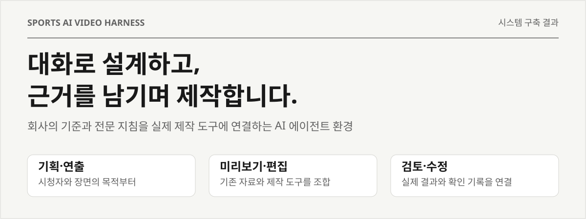
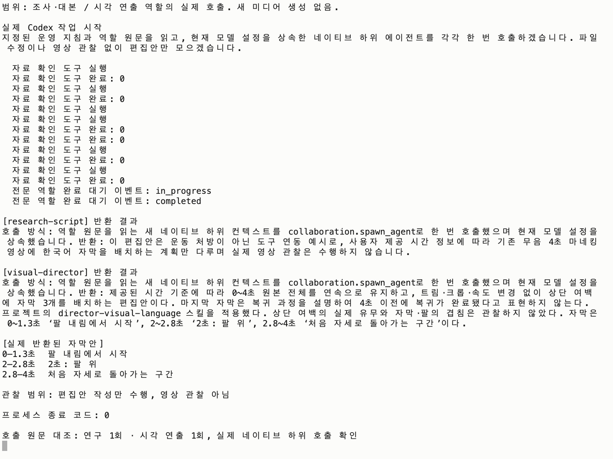
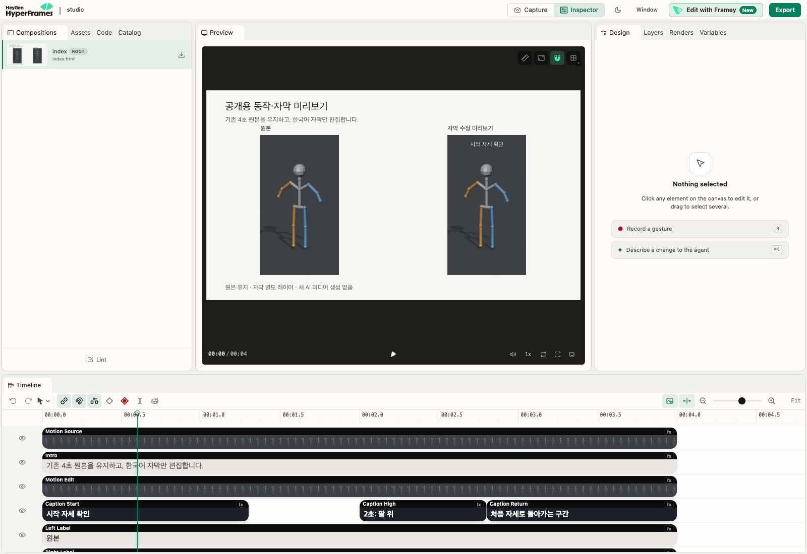
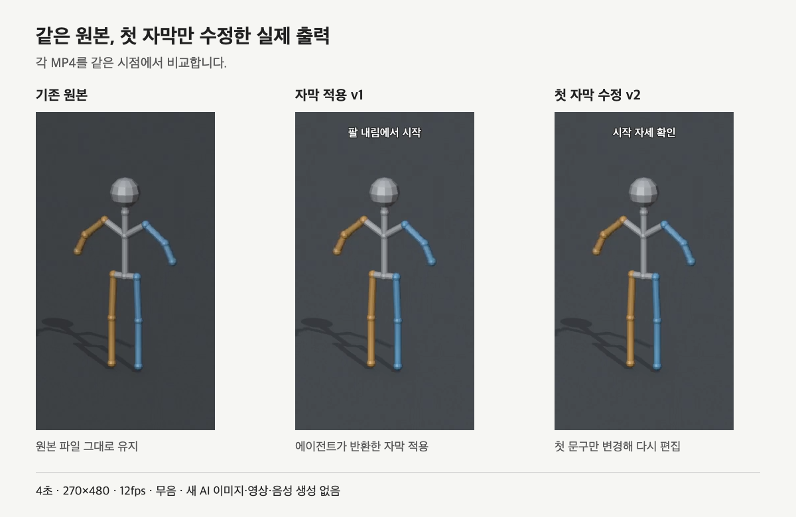
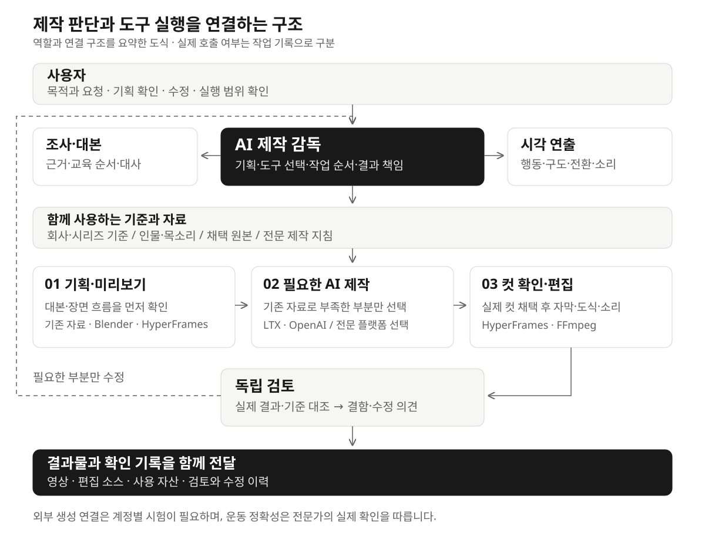
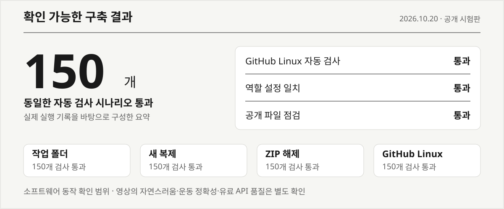

# Sports AI Video Harness



<p align="center">
  <a href="#무엇을-구축했나요">구축 결과</a> ·
  <a href="#실제로-어떤-작업을-했나요">실행 증빙</a> ·
  <a href="#시스템은-어떻게-움직이나요">시스템 구조</a> ·
  <a href="#어디까지-확인했나요">검증 근거</a> ·
  <a href="#사용은-이렇게-시작합니다">시작하기</a>
</p>

<p align="center">
  <a href="https://github.com/khakisketch/Sports-AI-Video-Harness/actions/workflows/ci.yml"></a>
</p>

## 무엇을 구축했나요?

**회사의 제작 기준을 바탕으로, 사용자가 AI와 대화하며 기획·미리보기·제작·편집·검수·수정까지 이어가는 작업 환경을 구축했습니다.**

영상은 이 환경에서 만들어지는 결과물 중 하나입니다. 핵심 구축물은 **판단하는 제작 감독, 전문 제작 지침, 실제 도구를 실행하는 연결부, 수정과 검토를 이어갈 기록 체계**입니다.

| 구분 | 구축 내용 |
|---|---|
| 적용 대상 | 스포츠·운동 교육 콘텐츠를 반복 제작하는 회사·센터·제작자 |
| 사용 방식 | 프로젝트 폴더를 열고, 파일과 도구를 다룰 수 있는 AI 에이전트에게 자연어로 요청 |
| 회사별 기준 | 시청자·브랜드·강사·의상·목소리·참고 동작·검토 담당을 정해 재사용 |
| 제작 방식 | 기존 자료와 로컬 편집을 조합하고, 필요한 장면에 외부 AI 모델을 선택해 연결 |
| 공개 결과 | 공통 실행 도구, 역할 설정, 전문 스킬, 제작·검수 양식, 설치·운영 안내 |

> **구축 방향**
>
> 무엇을 보여줄지 먼저 정하고 → 미리보기에서 확인하고 → 필요한 부분을 제작하고 → 실제 결과를 보고 수정합니다.

## 실제로 어떤 작업을 했나요?

**역할 설정만 나열하지 않고, 실제 에이전트 호출 → 미리보기 → 편집 → 부분 수정까지 실행했습니다.** 고객 자료 대신 기존 공개용 3D 마네킹을 사용했습니다.

> “기존 동작은 그대로 두고 한국어 안내를 붙여 줘. 미리보기에서 확인한 뒤 첫 자막만 더 쉽게 바꿔 줘.”
>
> 아래 실행 사례의 작업 범위를 쉽게 풀어 쓴 요청입니다.

| 입력 | 시스템이 실제 수행한 일 | 나온 결과 |
|---|---|---|
| 기존 4초 무음 마네킹 영상 | 조사·대본과 시각 연출 역할을 각각 실제 호출 | 한국어 자막 3개와 편집 방향 |
| 원본 + 반환된 자막안 | 미리보기 구성, 자막 합성, 영상 전체 디코딩 검사 | 편집 미리보기와 MP4 v1 |
| “첫 문구를 쉽게”라는 수정 조건 | 원본을 유지하고 첫 자막만 바꿔 다시 편집 | MP4 v2와 전후 비교 |

### 01 · 전문 역할이 실제로 판단한 기록

[](docs/evidence/agent-terminal.png)

*실제 Codex 실행 이벤트와 반환 결과를 읽기 전용 터미널로 연 화면입니다. 경로·세션 식별자는 제외했습니다. Codex 데스크톱 화면을 모사한 이미지가 아닙니다. 두 역할의 실제 호출은 원본 실행 기록과 대조했으며, 이 단계는 편집안 작성까지입니다.*

### 02 · 편집 가능한 미리보기에서 확인

[](docs/evidence/preview-studio.png)

*실제 HyperFrames Studio 화면입니다. 왼쪽은 원본, 오른쪽은 자막 레이어를 얹은 미리보기입니다. 브라우저 재생으로 4초 끝까지 진행하는 것을 확인했습니다. [팔을 올린 2.2초 시점도 보기 →](docs/evidence/preview-raised.png)*

### 03 · 원본을 재생성하지 않고 문구만 수정

[](docs/evidence/output-comparison.png)

*실제 MP4 세 개를 같은 시점에 연 화면입니다. ‘팔 내림에서 시작’을 ‘시작 자세 확인’으로 바꿨고, 동작 원본은 그대로 유지했습니다. 수정된 두 출력 모두 4초·270×480·12fps·48프레임이며 전체 디코딩 검사를 통과했습니다.*

**직접 열어 볼 결과물:** [원본 MP4](docs/evidence/source.mp4) · [자막 적용 v1](docs/evidence/edited-v1.mp4) · [문구 수정 v2](docs/evidence/edited-v2.mp4) · [실행 과정과 확인 범위](docs/실행사례.md)

이 사례는 **도구 연결과 부분 수정의 실제 작동 증빙**입니다. 새 AI 이미지·영상·음성 생성은 하지 않았습니다. 저해상도 무음 마네킹 시험이며, 실제 강사 영상의 자연스러움·음성 품질·운동 정확성을 입증하는 사례는 아닙니다.

## 시스템은 어떻게 움직이나요?



*현재 제공하는 역할·도구 연결을 요약한 구성도입니다. 연결 코드의 존재와 실제 계정에서의 제작 성공은 구분합니다.*

### 제작 감독이 판단하고, 전문 역할이 보완합니다

| 역할 | 맡는 일 | 남기는 결과 |
|---|---|---|
| **제작 감독** | 요청 파악, 콘셉트와 도구 선택, 작업 순서와 실행 범위 관리 | 제작 방향과 다음 작업 |
| **조사·대본** | 대상 시청자, 내용의 근거, 설명 순서와 대사 정리 | 근거와 연결된 대본 |
| **시각 연출** | 행동·구도·전환·소리·자막의 목적 설계 | 장면 흐름과 편집 방향 |
| **독립 검토** | 제작자의 판정과 분리해 실제 결과와 기준 대조 | 결함, 확인 범위, 수정 의견 |

필요한 단계에 해당 역할을 호출하도록 구성했습니다. 역할 정의와 전문 스킬은 **사용하는 에이전트 환경에서 실제로 호출해 쓰는 제작 지침**이며, 설치만으로 모든 역할이 자동 수행됐다고 기록하지 않습니다.

### 도구는 장면의 필요에 따라 조합합니다

| 제작할 내용 | 활용 경로 | 적용 방식 |
|---|---|---|
| 제목·자막·강조·도식 | **HyperFrames · FFmpeg** | 원본 위에 수정 가능한 편집 요소로 구성 |
| 공간·지지점·동작 전환 검토 | **Blender** | 필요한 장면의 3D 프리비주얼 |
| 새 영상·설명 음성 | **LTX · OpenAI 음성 API** | 현재 연결 코드 제공, 계정과 실행 범위 확인 후 사용 |
| 전문적인 인물·아바타·플랫폼 기능 | **Higgsfield · HeyGen** | 연결된 기능과 품질상 이점이 있을 때 선택 |

생성 모델은 외부 서비스에서 실행합니다. 고객에게 로컬 영상 생성 GPU나 별도의 연구용 장비를 필수로 요구하는 구조가 아닙니다.

## 사용자는 어떤 경험을 하나요?

아래는 **사용 흐름 예시**입니다. 사용자가 내부 도구 이름이나 명령어를 모두 지정할 필요는 없습니다.

| 단계 | 사용자가 말하는 것 | 받는 결과 |
|---|---|---|
| **01 · 방향 정하기** | “우리 센터 초보자에게 좋은 운동 쇼츠를 추천해 줘.” | 이유가 다른 주제 후보와 핵심 전개 |
| **02 · 먼저 보기** | “두 번째 안으로, 첫 동작 한 주기는 끊지 말고 보여 줘.” | 대본·장면 흐름과 기존 자료를 활용한 미리보기 |
| **03 · 제작하기** | “확인한 안으로 만들어 줘. 새 제작은 실행 범위를 먼저 알려 줘.” | 필요한 원본·계정·견적·한도를 확인한 구체적인 제작안 |
| **04 · 부분 수정** | “동작은 유지하고, 이 구간 자막과 설명 시점만 맞춰 줘.” | 채택 원본을 유지한 해당 구간 편집 |
| **05 · 확인·전달** | “영상과 편집 원본, 확인한 내용까지 정리해 줘.” | 결과물과 실제 검토·미확인 사항을 구분한 기록 |

> **기록이 이어지는 제작**
>
> 한 번 채택한 인물·원본·장면은 다음 편과 수정 작업의 기준으로 남깁니다. 자막만 바꿀 때는 편집을, 인물이나 동작에 문제가 있을 때는 해당 컷을 수정하도록 영향 관계를 구분합니다.

## 반복 제작을 위해 갖춘 기능

| 기능 | 시스템에서 다루는 내용 | 운영상 의미 |
|---|---|---|
| **회사·시리즈 기준** | 강사·목소리·화면 톤·기준 자산과 버전 | 다음 편에서도 같은 기준으로 출발 |
| **장면별 계획** | 대사·행동·구도·시작과 끝·전환 이유 | 설명과 화면의 연결을 생성 전에 검토 |
| **컷별 채택** | 실제 결과의 관찰과 사용 여부 | 미확인 컷과 본편에 채택한 컷을 구분 |
| **부분 수정** | 원본과 편집 요소의 연결 관계 | 관련 없는 원본을 유지하고 수정 범위 한정 |
| **실행 전 확인** | 현재 입력·승인 범위·견적·한도·기존 작업 | 설치나 과거 승인을 새 제작 권한으로 해석하지 않음 |
| **작업 회수** | 저장된 작업 조회와 결과 다운로드 | 중단 후 기존 작업부터 확인, 자동 재제출 방지 |
| **검토 기록** | 기술 검사·실제 관찰·전문가 의견·인수 확인 | 무엇을 확인했고 무엇이 남았는지 구분 |

전문 지식은 연출·스토리보드·인물 일관성·편집·미리보기 등에 필요한 **24개 스킬**로 구성했습니다. 공개판에는 재배포 조건을 확인한 자료와 원저작권 고지를 포함했습니다.

## 어디까지 확인했나요?

[](https://github.com/khakisketch/Sports-AI-Video-Harness/actions/runs/39357010015)

*초기 공개 시험판의 실제 검사 기록을 바탕으로 구성한 결과 요약입니다. 이미지를 누르면 해당 공개판의 GitHub 실행 원문을 볼 수 있습니다.*

| 확인 항목 | 결과 | 확인 근거 |
|---|---|---|
| **공개판 자동 검사** | 동일한 150개 검사 통과 | 작업 폴더·새 복제·ZIP 압축 해제 후 검사 기록 |
| **GitHub 환경 실행** | Linux에서도 150개 검사 통과 | [공개 실행 기록](https://github.com/khakisketch/Sports-AI-Video-Harness/actions/runs/39357010015) |
| **역할 설정 일치** | 공통 역할과 각 에이전트 환경의 설정 일치 | 같은 실행 기록의 역할 설정 확인 단계 |
| **공개 파일 점검** | 정해진 점검 규칙에서 발견 항목 없음 | 같은 실행 기록의 공개 파일 점검 단계 |
| **배포 파일 동일성** | 업로드한 ZIP의 SHA-256 일치 | [배포본과 파일 확인값](https://github.com/khakisketch/Sports-AI-Video-Harness/releases/tag/v0.1.0-preview.1) |

자동 검사는 **계획·실행 조건·장면 관계·수정·복구 등 소프트웨어 동작**을 확인합니다. 외부 API 응답은 모의 응답으로 검사했으며, 실제 유료 제작 성공을 뜻하지 않습니다. 영상의 자연스러움, 직접 청취와 운동 정확성은 실제 결과를 별도로 검토합니다.

[검증 항목과 확인 범위 자세히 보기 →](docs/검증결과.md)

<details>
<summary><strong>현재 제공 범위와 추가 확인 대상</strong></summary>

| 구분 | 현재 상태 |
|---|---|
| 제작 역할·전문 스킬·운영 기준 | 구성 및 설정 연결 검사 완료 |
| 계획·승인 범위·컷 채택·부분 수정·복구 처리 | 구현, 오프라인 동작 검사 완료 |
| FFmpeg 편집·HyperFrames 미리보기·Blender 연결 | 실행 도구 제공, 새 사용자 환경의 도구·폰트는 설치 확인 필요 |
| LTX 영상·OpenAI 문자 과금 음성 | 실행 연결 코드 제공, 실제 계정 접근·유료 품질 시험은 별도 |
| 이미지·립싱크·보이스 복제 | 공통 작업 종류 정의, 실행 연결은 미구현 |
| Wan·fal.ai·Replicate·RunPod | 연결 검증 전 후보 |
| Claude Code | 역할·지침 설정 제공, 실제 전체 실행 검증은 별도 |
| 고객용 웹 서비스·클라우드 편집 작업자 | 설계 단계, 구현·배포 완료 상태 아님 |
| 운동 전문가 확인·고객 인수 | 해당 결과물과 실제 담당자의 확인 필요 |

</details>

## 회사에 맞게 어떻게 적용하나요?

처음에는 **회사의 대상 시청자와 제작 목적**부터 이야기하면 됩니다. 운영하면서 필요한 기준을 함께 정리합니다.

| 정할 기준 | 예시 |
|---|---|
| 콘텐츠 | 대상 시청자, 교육 목적, 자주 다룰 주제 |
| 인물·소리 | 강사와 의상, 사용할 목소리, 자료 사용권 |
| 화면 | 말투·자막·색감·길이·게시 형식 |
| 확인 담당 | 내용 검토, 운동 동작 확인, 최종 인수 담당 |
| 실행 환경 | 사용할 AI 계정, 편집 도구, 자료 보관 위치 |

공개 배포에는 공통 시스템과 빈 양식을 담았습니다. 실제 회사 자료·인물 원본·고객 생성 영상·검수와 서명 자료는 회사별 비공개 자료로 보관합니다. 위 실행 증빙에는 회사 자료와 분리한 공통 도구 시험만 담았습니다.

## 사용은 이렇게 시작합니다

**에이전트에게 아래 내용을 그대로 요청하세요.**

```text
https://github.com/khakisketch/Sports-AI-Video-Harness

이 프로젝트를 내 작업 폴더에 준비하고 운영 지침을 읽어 줘.
필요한 도구의 설치 상태와 가능한 작업부터 확인해 줘.
회사와 콘텐츠 기준은 나와 대화하며 정리하고,
먼저 기존 자료로 기획안과 미리보기를 준비해 줘.
새 유료 생성·업로드·게시 전에는 실행 범위를 확인해 줘.
```

이미 내려받았다면 Codex 또는 Claude Code 등 **프로젝트 파일과 로컬 도구를 다룰 수 있는 환경**에서 그 폴더를 열고 요청하면 됩니다. 일반 웹 채팅에 링크만 붙여 넣는 것으로 로컬 실행 도구가 설치되지는 않습니다.

<p>
  <a href="https://github.com/khakisketch/Sports-AI-Video-Harness/releases/tag/v0.1.0-preview.1"><strong>공개 시험판 다운로드</strong></a> ·
  <a href="docs/사용안내.md">사용 안내</a> ·
  <a href="docs/설치.md">설치 담당자 안내</a> ·
  <a href="docs/납품확인.md">납품 확인 양식</a>
</p>

---

**공개판 · 0.1.0-preview.1**　|　**구축·검증 기준일 · 2026.10.20**

자체 작성 코드에는 [MIT](LICENSE)를 적용합니다. 포함된 외부 스킬·실행 도구·폰트·모델 서비스는 각각의 이용 조건을 따릅니다. [외부 저작물 고지](THIRD_PARTY_NOTICES.md) · [변경 이력](CHANGELOG.md)
